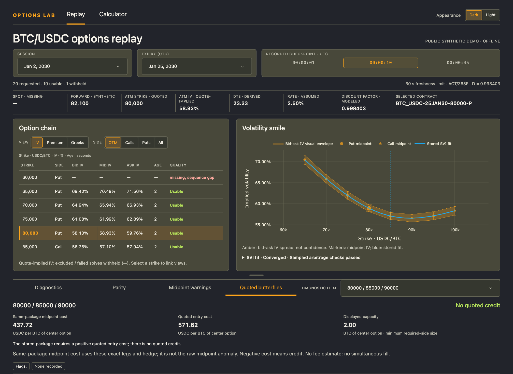

# Quantitative Pricing Toolkit

A typed, vectorized, and numerically defensive implementation of the
Black–Scholes–Merton model for European options. The project emphasizes the work
that matters in a quantitative production library: explicit assumptions,
stable boundary behavior, analytic risk, robust inversion, invariant-based
testing, and measured performance.

## Implemented scope

- European call and put pricing with continuous dividends
- Analytic Delta, Gamma, Vega, calendar Theta, and Rho
- Safeguarded implied volatility with no-arbitrage validation and diagnostics
- NumPy broadcasting for heterogeneous batch pricing
- Explicit expiry and zero-volatility conventions
- Stable log-CDF tail evaluation for extreme moneyness
- Typed command-line and Dash interfaces that delegate to the pricing package
- Immutable market-data contracts and an offline, as-of bid/ask IV example
- Dated curves, Black-76 pricing and IV, and bid/ask parity diagnostics
- Optional partitioned Parquet ingestion and causal snapshot replay
- Liquidity-weighted SVI calibration, bid/mid/ask IV, and surface diagnostics
- Portfolio Greeks, scenario shocks, P&L attribution, and risk limits
- Independent binomial reference for European and American exercise with
  discrete cash dividends
- Regression, finite-difference, parity, monotonicity, randomized invariant,
  edge-case, and integration tests
- Ruff formatting/linting, strict mypy checks, locked dependencies, and CI

See [ROADMAP.md](ROADMAP.md) for remaining work and
[IMPLEMENTATION_SUMMARY.md](IMPLEMENTATION_SUMMARY.md) for design decisions and
reproducible workflows.

## Model and conventions

For spot $S$, strike $K$, time to expiry $T$, continuously compounded
risk-free rate $r$, continuous dividend yield $q$, and annualized volatility
$\sigma$:

$$
d_1 =
\frac{\ln(S/K) + (r-q+\tfrac{1}{2}\sigma^2)T}
     {\sigma\sqrt{T}},
\qquad
d_2 = d_1-\sigma\sqrt{T}.
$$

$$
C = Se^{-qT}N(d_1)-Ke^{-rT}N(d_2),
\qquad
P = Ke^{-rT}N(-d_2)-Se^{-qT}N(-d_1).
$$

The implementation assumes European exercise, frictionless markets, continuous
trading, constant rates and volatility, lognormal diffusion, and no discrete
cash dividends. Rates, yields, and volatility are decimal annualized inputs.

Greek conventions are explicit:

- Vega and Rho are derivatives for a unit change in volatility and rate. Divide
  by 100 for a one-percentage-point sensitivity.
- Theta is calendar theta per year, so it is the negative derivative with
  respect to remaining maturity.
- At expiry, price is exact intrinsic value. Delta uses 0.5 at the payoff kink;
  Gamma, Vega, Theta, and Rho are reported as zero because their distributional
  limits are not finite point sensitivities.
- At zero volatility, price is the discounted deterministic payoff. First-order
  sensitivities use one-sided limits and midpoint values at the deterministic
  exercise boundary.

## Numerical design

Pricing validates finite, broadcast-compatible inputs and rejects non-positive
spot/strike, negative maturity, negative volatility, and discount factors that
overflow IEEE-754 double precision. OTM tail terms are evaluated in log space
with `log_ndtr` and `expm1`, reducing cancellation between nearly equal terms.

Implied volatility is solved only after checking the European no-arbitrage
bounds:

$$
\begin{aligned}
\max(Se^{-qT}-Ke^{-rT},0) &\le C < Se^{-qT},\\
\max(Ke^{-rT}-Se^{-qT},0) &\le P < Ke^{-rT}.
\end{aligned}
$$

The solver expands a volatility bracket, accepts
Newton updates only inside a safeguarded interior, and otherwise bisects.
Success returns volatility, iteration count, residual, normalized residual,
termination reason, final bracket, and the repriced value. Bound violations,
infinite-volatility limits, bracket failures, and iteration failures are
distinct exceptions.

Price convergence combines an absolute tolerance with a relative tolerance
times a no-arbitrage-bound-derived monetary scale. The default absolute
tolerance is zero, making identical economics produce the same implied
volatility whether prices are quoted in dollars, cents, or normalized notional
units. A narrow volatility bracket is a separate, explicitly reported stopping
condition. This distinction matters for low-Vega options: a tiny normalized
price residual does not imply many meaningful decimal places of volatility.

## Installation

The supported Python versions are 3.10 and newer. Install
[uv](https://docs.astral.sh/uv/getting-started/installation/) first; `uv.lock`
records the resolved environment used by CI and the reference benchmark.
The following installs the dashboard and Parquet replay extras, development
tools, and benchmark tools into the project environment:

```bash
git clone https://github.com/karisheen/Black-Scholes-Pricing-Model.git
cd Black-Scholes-Pricing-Model
uv sync --locked --extra dashboard --extra replay --group dev --group benchmark
```

For library-only use with `pip`:

```bash
python -m pip install .
```

Install the optional dashboard dependencies with:

```bash
python -m pip install ".[dashboard]"
```

Install `".[replay]"` for partitioned Parquet ingestion and replay. The pricing
engine does not require PyArrow.

## Python API

Scalar pricing and risk:

```python
from quant_pricing import value_and_greeks

result = value_and_greeks(
    "call",
    spot=100.0,
    strike=100.0,
    time_to_expiry=1.0,
    rate=0.05,
    volatility=0.20,
    dividend_yield=0.0,
)

print(result.price)         # 10.450583572...
print(result.greeks.delta)  # 0.636830651...
print(result.greeks.vega)   # 37.524034692 per unit volatility
```

Broadcast batch pricing:

```python
import numpy as np
from quant_pricing import price

spots = np.array([[80.0], [100.0], [120.0]])
strikes = np.array([90.0, 100.0, 110.0])
values = price("put", spots, strikes, 0.5, 0.03, 0.25)
assert values.shape == (3, 3)
```

Implied volatility with diagnostics:

```python
from quant_pricing import implied_volatility

solution = implied_volatility(
    "call",
    target_price=10.450583572,
    spot=100.0,
    strike=100.0,
    time_to_expiry=1.0,
    rate=0.05,
)

print(solution.volatility)  # approximately 0.20
print(solution.normalized_residual, solution.termination_reason)
print(solution.iterations, solution.bracket)
```

## Applications

Run a reproducible CLI valuation:

```bash
uv run black-scholes \
  --spot 100 --strike 100 --time 1 \
  --rate 0.05 --volatility 0.20 --type call
```

### Options Lab dashboard

Options Lab is a local, read-only replay workspace for historical linear
BTC/USDC options and their same-expiry futures. Start with the deterministic,
clearly labeled **public synthetic demo** (no private reports required):

```bash
uv run --extra dashboard black-scholes-dashboard
```

To inspect your own local reports already produced by the historical replay
pipeline (private reports are not bundled or publicly accessible):

```bash
OPTIONS_LAB_REPORTS=/private/path/to/reports \
  uv run --extra dashboard black-scholes-dashboard
```

The configured directory is the only private-report input. Only direct
`*-report.json` files are matched; subdirectories are not searched. There is no
browser file picker or remote upload. A supplied directory loads historical
reports only: empty directories and malformed reports are reported, never
replaced with demo data. The app does not fetch live quotes, execute orders, or
send report data to an external host. Keep the server local; this is not an
authenticated multi-user data service.

#### Replay workspace

Use the **Session** and **Expiry (UTC)** dropdowns and the discrete
**Recorded checkpoint · UTC** tabs to choose a recorded replay slice. Checkpoints
are not a dropdown or continuous playback timeline; there is no play control.
The **Option chain** opens with **View: IV** and **Side: OTM**. Switch **View**
between **IV**, **Premium**, and **Greeks**, or **Side** between **OTM**, **Calls**,
**Puts**, and **All**. Select a contract in the table or an observed
**Volatility smile** point. Fitted curve points are not contracts. A retained
selection remains selected only while it is visible; otherwise the nearest
visible strike to the observed forward is selected.

The context strip distinguishes **Spot** from the same-expiry **Forward** and
labels missing, synthetic, quoted, quote-implied, derived, assumed, and modeled
context explicitly. Missing spot is unavailable, not copied from the forward.
**ATM strike** is quoted; **ATM IV** is quote-implied, not an observed volatility.
**DTE** is derived from the selected UTC cutoff and expiry, not the filename.
**Rate** is assumed and **Discount factor** is modeled. IV and model values use
the recorded matched-future BBO midpoint, discount factor, ACT/365F maturity,
and explicit continuously compounded rate assumption. Neither venue marks nor
parity-implied forwards silently replace missing futures. IV is annualized
decimal in exports; displayed percentages are presentation only.

The contract panel preserves native and normalized quote information, IV solver
results, timestamps, model assumptions, and risk units. Supported Greeks are
conditional model sensitivities, not observed returns or hedging guarantees.
Forward-based risk is not spot risk; unsupported Greeks and missing inputs remain
unavailable rather than zero. Read the displayed risk basis and units before
comparing contracts or scaling by position size.

Quality labels are separate: quote usability, freshness, IV availability,
fit eligibility, and diagnostic findings are not interchangeable. Freshness uses
the report's quote-age threshold at the selected checkpoint; receipt availability
and exchange time remain distinct. Crossed, missing, stale, or otherwise rejected
books remain inspectable without being promoted to usable observations. A green
usable label is not a liquidity, fill, or profit guarantee.

Four diagnostic tabs share a **Diagnostic item** selector; **Quoted butterflies**
is selected by default:

- **Diagnostics:** coverage, fit warnings, and individual option-book quality.
- **Parity:** a selected matched call/put pair and its independent future context.
- **Midpoint warnings:** observed midpoint-based findings for the selected expiry's
  ACT/365F maturity, not executable opportunities. Older calendar evidence may
  lack the prior expiry or its legs; those limitations remain explicit.
- **Quoted butterflies:** a selected quoted package, its legs and bid/ask basis.
  The same-package midpoint comparison holds the stored legs and future hedge
  fixed; it is not the worst-case observed midpoint signal. Stale, sequence-invalid,
  or missing BBO inputs block the comparison rather than inventing prices.

Checks retain their original limits. Finite-grid fitted-surface checks are not
proofs of global arbitrage freedom. Butterfly costs use displayed indicative
bid/ask sides where available, but are **before fees**, slippage, latency, and
fill uncertainty; a candidate is neither an order nor evidence that simultaneous
fills occurred.

#### Local exports and data licensing

Choose **Visible chain**, **IV observations**, **Fitted slice**, **Selected
contract**, or **Selected diagnostic** under **Export scope**, select CSV or JSON
under **Format**, and click **Export view**. Chain and IV exports honor the side
filter; contract and diagnostic exports retain only the selected item plus its
context.
Diagnostic exports preserve raw evidence with annotated option/future inputs;
changing the selection does not refit a surface or reingest the capture.
Sorted records/keys include the exact cutoff and expiry, session/source and
synthetic flag, selection/mode, units, assumptions, rate and forward provenance,
normalized flags, and diagnostic limitations. CSV uses scalar columns and JSON
for structured fields; nulls are empty cells (JSON preserves null explicitly).
An empty scope exports zero JSON records or a metadata-only CSV row. Downloads
are generated in memory for the local browser, without server-side export files.

Private historical data remains subject to the provider's license and your
access rights. Keep captures, reports, private exports, and private screenshots
outside the repository; do not redistribute vendor data. The screenshot below
uses only the public synthetic demo. Synthetic books illustrate behavior, not
live-market quality, trading performance, or empirical calibration validation.



*Desktop: public synthetic demo with recorded checkpoint tabs, the default IV
chain, volatility smile, and Quoted butterflies diagnostics.*

#### Calculator

The **Calculator** retains manual **Price from volatility** and **IV from option
premium** workflows. Supply premium per unit, not total contract cost. Results
include theoretical price, Greeks, sensitivity charts, and (for IV) the signed
repricing residual, iteration count, and stopping reason. Click **Calculate** to
apply pending inputs; switching the persistent light/dark theme restyles the
last calculated result without applying those edits. The calculator does not
fetch market data or estimate volatility from returns.

The original `bs_call`, `bs_put`, `d1`, and `d2` names remain available through
`BlackScholesPricingModel.py` for existing notebooks.

### Offline option chain

Run the [frozen synthetic chain](examples/synthetic_option_chain.json) from
the repository root:

```bash
uv run python -m quant_pricing.option_chain \
  examples/synthetic_option_chain.json --as-of 2025-01-01T12:00:00Z
```

- **12:00:00 UTC:** The clean, synthetic chain recovers the known 19% bid and
  21% ask IV at each strike.
- **12:00:30 UTC:** `C100` is crossed; the report shows the raw quote but no IV.
  `P100` still uses sequence 1 because its revision, stamped 12:00:20, does
  not arrive until 12:00:45.
- **12:01:00 UTC:** `P100` uses sequence 2, the now-available revision.

The instrument universe is fixed in the fixture. The JSON report retains
quote and availability times, source sequence, raw prices and sizes, premium
basis, and quality flags. Both clocks must be at or before the cutoff.
Selection is deterministic within the declared source: latest quote time,
then sequence, then availability time. Freshness is measured from quote time.
Missing quotes are not filled; bad or stale quotes are not replaced by older
ones.

Use `quant_pricing.market.SnapshotProvider` at the application boundary;
`FrozenQuoteProvider` implements it over an immutable quote tape. A snapshot's
rows distinguish a missing observation from an observed but unusable quote.

The workflow uses the eligible spot midpoint, fixed decimal rate and dividend
yield, and elapsed UTC seconds on an ACT/365F basis. It solves each side
separately for single-currency European cash-settled options; forward quotes
have a domain type but are not used here. Per-contract premiums are divided
by the multiplier without changing the denomination. Option quote sizes and
positions are in contracts; underlying and forward sizes are in underlying
units. Coin premiums can be represented and normalized in the domain model,
but the IV workflow does not convert currencies or model inverse payoffs.

For persistent replay, ingest into a fresh writable archive and rerun the same
as-of query without `--ingest`:

```bash
uv run --extra replay python -m quant_pricing.option_chain \
  examples/synthetic_option_chain.json --as-of 2025-01-01T12:00:30Z \
  --archive /tmp/quant-chain-example --ingest
uv run --extra replay python -m quant_pricing.option_chain \
  examples/synthetic_option_chain.json --as-of 2025-01-01T12:00:30Z \
  --archive /tmp/quant-chain-example
```

The report includes bid/ask-implied forward intervals and carries a separate
spot-derived forward benchmark. It withholds IV or parity calculations that
depend on an unavailable, invalid, stale, crossed, or sequence-gapped quote.

### Historical Deribit order-book replay

Download a two-minute [free Tardis sample](https://docs.tardis.dev/historical-data-details/deribit)
to a private directory outside the repository. This reads a historical feed,
not the live Deribit API. No credential is needed for this first-of-month sample.

```bash
capture=$(mktemp "${TMPDIR:-/tmp}/tardis-deribit.XXXXXX")
curl -fsS --compressed --get 'https://api.tardis.dev/v1/data-feeds/deribit' \
  --data-urlencode 'from=2024-01-01' \
  --data-urlencode 'sliceSize=2' \
  --data-urlencode 'filters=[{"channel":"book","symbols":["BTC-29MAR24-45000-C","BTC-29MAR24-45000-P","BTC-29MAR24-46000-C"]}]' \
  --output "$capture" &&
uv run python -m quant_pricing.tardis_deribit "$capture" \
  --symbol BTC-29MAR24-45000-C \
  --symbol BTC-29MAR24-45000-P \
  --symbol BTC-29MAR24-46000-C \
  --as-of 2024-01-01T00:00:20Z \
  --as-of 2024-01-01T00:00:30.4Z \
  --as-of 2024-01-01T00:00:31Z
```

The report shows a usable three-book snapshot, a disconnect with quotes
withheld, and fresh snapshots on recovery. Repeat the command on the same
bytes to reproduce the result. `--as-of` cutoffs are inclusive, strictly
increasing UTC times; queries after the last dated frame fail.

Removing one update from this sample also produced a gap for only the affected
instrument. Its next full snapshot restored a usable book.

- Use contiguous **raw** Tardis capture slices, not CSV, grouped books, or
  concatenated noncontiguous downloads. Replay follows capture receipt order,
  retaining fractional timestamp precision and file order for ties. It also
  reports venue time and withholds state if any applied dependency is dated
  after the cutoff. Tardis receipt time represents the vendor's observation
  clock, not when this project downloaded the file.
- A change must link to the last accepted venue ID; the ID need not increment
  by one. A broken link invalidates only that instrument. An untimestamped
  Tardis disconnect marker conservatively invalidates all requested books just
  after the preceding receipt (or in file order for equal receipt times).
  The marker does **not** identify the precise outage time. Recovery requires a
  new snapshot for each affected instrument.
- Prices and amounts are native decimal strings. Stale, crossed, and
  one-sided books are flagged, not counted as complete. This sample is for
  book reconstruction only: it is not a normalized `MarketSnapshot`, a
  linear Black–76 input, or execution evidence.
- Keep the capture and event-level output private under the
  [Tardis licence](https://docs.tardis.dev/legal/terms-of-service#9-licence).
  Tests use synthetic frames, not redistributed market data.

### BTC/USDC chain and IV quality report

Run this Bash example from the repository root. It requests two minutes of
free Tardis history for two dated futures and 40 linear BTC/USDC options.
The download and report stay in a private directory outside the repository.

```bash
work=$(mktemp -d "${TMPDIR:-/tmp}/btc-usdc-chain.XXXXXX")
strikes=(76000 78000 80000 82000 84000 85000 86000 88000 90000 92000)
filter=$(python3 -c '
import json, sys
symbols = []
for expiry in ("30OCT26", "27NOV26"):
    future = f"BTC_USDC-{expiry}"
    symbols.append(future)
    symbols.extend(f"{future}-{k}-{s}" for k in sys.argv[1:] for s in "CP")
print(json.dumps([{"channel": "book", "symbols": symbols}]))
' "${strikes[@]}")
strike_args=()
for strike in "${strikes[@]}"; do strike_args+=(--strike "$strike"); done
curl -fsS --compressed --get 'https://api.tardis.dev/v1/data-feeds/deribit' \
  --data-urlencode 'from=2026-10-01' --data-urlencode 'sliceSize=2' \
  --data-urlencode "filters=$filter" --output "$work/capture.ndjson" &&
uv run python -m quant_pricing.deribit_chain "$work/capture.ndjson" \
  --expiry 30OCT26 --expiry 27NOV26 "${strike_args[@]}" --rate 0 \
  --as-of 2026-10-01T00:00:20Z --as-of 2026-10-01T00:00:45Z \
  --as-of 2026-10-01T00:01:30Z > "$work/iv-quality.json" &&
jq '.checkpoints[] | {as_of, expiries: [.expiries[] | {expiry, coverage, fit_error}]}' \
  "$work/iv-quality.json"
```

- **Units:** For [Deribit linear BTC/USDC options](https://support.deribit.com/hc/en-us/articles/31424932728093-Linear-USDC-Options),
  one option contract represents one BTC. Prices are USDC per BTC. Convert
  native BTC amounts to option contract counts; dated-future sizes remain BTC.
  The adapter is scoped to this product family, not inverse or USD contracts.
- **Inputs:** Use the as-of midpoint of a fresh two-sided book for the exact
  matching dated future as a forward proxy. `--rate 0` gives discount factor
  one, matching the venue's documented formula; it is not a USDC funding
  estimate. Do not use a venue mark or parity-derived forward as a fallback.
  Do not price during or after the 30-minute settlement window.
- **Quality:** Retain the native book, normalized units and both clocks.
  Reject unsafe books, and report bid, premium-midpoint, and ask IV errors
  separately. Show book age, spread, parity-implied intervals versus the
  observed futures spread, and fit failures per expiry. A failed fit does not
  erase valid IV or a fit for another expiry.
- **Fit:** Use one positive liquid OTM midpoint IV per strike. Report SVI
  residuals and check raw midpoint and fitted-grid violations separately.
  Midpoint findings are not executable-arbitrage claims; a clean fitted grid
  is not a global proof.

In the sample, all 40 contracts had two-sided IV at the first cutoff. Eight
books later failed the 30-second freshness gate, but both expiry fits still
had ten eligible OTM strikes. This is one short session, not a liquidity or
execution backtest. Real samples and full reports are not in version control.

#### Freeze strikes from the Tardis catalog

Instead of a fixed grid, choose strikes from a complete [Tardis `/symbols` response](https://docs.tardis.dev/api/http-api-reference#symbols)
queried for the **previous UTC day**, with the replay day as the exclusive
end. The selector also rejects contracts first seen on or after the replay
day, because archive availability is day-granular. This is an archive-based
universe, not an official historical exchange listing feed.

```bash
work=$(mktemp -d "${TMPDIR:-/tmp}/btc-usdc-catalog.XXXXXX")
curl -fsSG --compressed 'https://api.tardis.dev/v1/symbols' \
  --data-urlencode 'exchanges=deribit' --data-urlencode 'baseCurrency=BTC' \
  --data-urlencode 'quoteCurrency=USDC' --data-urlencode 'type=option' \
  --data-urlencode 'availableSince=2026-07-31' \
  --data-urlencode 'availableTo=2026-08-01' --data-urlencode 'limit=1000' \
  --output "$work/catalog.json"

tardis_book() {
  curl -fsSG --compressed 'https://api.tardis.dev/v1/data-feeds/deribit' \
    --data-urlencode 'from=2026-08-01' --data-urlencode "sliceSize=$1" \
    --data-urlencode "filters=$2" --output "$3"
}
tardis_book 1 '[{"channel":"book","symbols":["BTC_USDC-28AUG26","BTC_USDC-25SEP26"]}]' \
  "$work/futures.ndjson" &&
uv run python -m quant_pricing.deribit_chain "$work/futures.ndjson" \
  --catalog "$work/catalog.json" --expiry 28AUG26 --expiry 25SEP26 \
  --as-of 2026-08-01T00:00:10Z > "$work/selection.json" &&
tardis_book 2 "$(jq -c .tardis_filter "$work/selection.json")" "$work/books.ndjson" &&
uv run python -m quant_pricing.deribit_chain "$work/books.ndjson" \
  --selection "$work/selection.json" --rate 0 \
  --as-of 2026-08-01T00:00:20Z --as-of 2026-08-01T00:01:30Z > "$work/report.json"
```

The planner freezes up to nine paired call/put strikes by absolute log
moneyness to each expiry's own dated future, before inspecting option books.
It records the catalog checksum and the futures observations used to select
strikes. The report validates those anchors against the full tape, refuses
earlier cutoffs, and keeps missing strikes instead of replacing them. A
paginated catalog must first be combined into a complete local response.

Each expiry now has a separate `quoted_butterflies` report. It checks
adjacent selected strike triplets using asks for bought wings and bids for
the sold center, including unequal strike spacing. The check considers
call/put substitutions and crosses the dated futures spread for the net
hedge. It reports the lowest entry cost, constituent legs, and an indicative
size cap. A negative cost is a **candidate before fees**, not a simultaneous
fill or tradable lot guarantee. Missing or unusable legs reduce coverage;
the scan does not bridge gaps or replace midpoint diagnostics.

Across the four Aug-Nov first-of-month sample days, this rule recovered
both expiry fits at all three checkpoints per day. The fixed grid previously
missed the August back expiry. The new scan checked 168 triplet observations
with no negative quoted entry cost, despite 53 midpoint findings. These are
repeated checks on short recorded sessions, not independent trading trials.

### Synthetic surface, portfolio, and exercise workflow

```bash
uv run python examples/p3_research_workflow.py
```

Fit a clean and deliberately damaged synthetic chain, reprice a portfolio
against the fitted surface, and compare European and American exercise with
a discrete cash dividend. This is a verification workflow, not a backtest.

### Synthetic delta hedging and P&L attribution

```bash
uv run python -m quant_pricing.hedge_experiment \
  examples/hedging_experiment.json --output-dir /tmp/hedging-research
```

Compare an unhedged European option with periodic and delta-band hedges on
the **same seeded spot paths**. The experiment varies generating volatility
and spot execution costs independently of the volatility used to mark the
option. It runs offline without Dash, market-data credentials, or a live feed.
See the [research report](docs/hedging-research.md) for the accounting
identities, reproduction details, measured trade-offs, and limitations.

## Validation and quality checks

```bash
uv run pytest --cov --cov-report=term-missing
uv run ruff format --check .
uv run ruff check .
uv run mypy
uv build
```

The test suite validates:

- canonical published prices and Greeks for the $S=K=100$ one-year case;
- analytic Greeks against central finite differences;
- dividend-adjusted put–call parity and call/put Greek identities;
- no-arbitrage bounds and expected monotonicity;
- deterministic randomized parity across broad parameter ranges;
- extreme moneyness, near expiry, zero volatility, negative rates, malformed
  inputs, and non-broadcastable arrays;
- implied-volatility recovery and every documented failure regime;
- monetary-scale invariance and final-iteration convergence in the solver; and
- CLI, compatibility wrapper, dashboard calculation, layout, and callback
  initialization.

## Performance

The reference microbenchmark prices 10,000 heterogeneous calls. On the
development machine, the scalar loop averaged 2.072 seconds and the vectorized
path averaged 1.644 milliseconds—about a 1,261× speedup. This measures the
intended amortization of Python conversion, validation, and call overhead; it is
not treated as a cross-machine performance guarantee.

See [BENCHMARKS.md](BENCHMARKS.md) for methodology, caveats, and reproduction
commands.

## Architecture

```text
src/quant_pricing/
├── black_scholes.py         # deterministic pricing, bounds, and Greeks
├── black76.py               # forward pricing, bounds, and IV
├── conventions.py           # day-count and exchange calendar rules
├── curves.py                # discount, forward, and cash-dividend curves
├── implied_volatility.py    # safeguarded scalar root solve
├── market.py               # instruments, quotes, and as-of snapshot contract
├── replay.py                # synthetic provider and optional Parquet archive
├── tardis_deribit.py        # native historical book reconstruction and CLI
├── deribit_chain.py         # historical linear BTC/USDC IV quality report
├── deribit_catalog.py       # deterministic prior-day strike selection
├── butterfly.py             # spread-aware weighted butterfly diagnostics
├── parity.py                # parity and conditional carry diagnostics
├── treasury.py              # Federal Reserve GSW zero-yield adapter
├── synthetic_chain.py       # deterministic SSVI chains and injected quote faults
├── surface.py               # IV observations, SVI fits, and arbitrage checks
├── risk.py                  # portfolio Greeks, scenarios, attribution, and limits
├── hedge_paths.py           # seeded GBM scenarios and spot/forward initialization
├── hedging.py               # causal spot-hedge policies and self-financing ledger
├── hedge_experiment.py      # paired experiments, metrics, and research CLI
├── binomial.py              # independent listed-option exercise reference
├── option_chain.py          # frozen-chain CLI and per-side IV report
├── cli.py                   # command-line adapter
├── dashboard.py             # Options Lab shell, calculator, and Dash entry point
├── lab_data.py              # local report validation, selection, and risk adapters
├── lab_workspace.py         # replay layout, atomic selection, and callbacks
├── lab_chain.py             # chain, context, contract, smile, and fit views
├── lab_diagnostics.py       # selected diagnostic evidence and panels
├── lab_export.py            # deterministic in-memory CSV/JSON downloads
├── lab_demo.py              # public synthetic books through production replay
├── exceptions.py            # domain-specific failures
└── py.typed                 # PEP 561 typing marker

tests/                       # numerical, invariant, and integration tests
benchmarks/                  # correctness-checked performance experiments
.github/workflows/ci.yml     # multi-version quality gate
```

Pricing and numerical methods do not depend on Dash or external market data.
The UI layer is optional and one-way: applications depend on the library, never
the reverse.

`src/quant_pricing/dashboard.py` loads reports through `lab_data.py` and mounts
`lab_workspace.py` alongside the calculator. The workspace resolves one shared
selection for `lab_chain.py`, `lab_diagnostics.py`, and `lab_export.py`; diagnostic
panels and exports use the same evidence payload. With no report directory,
`lab_data.py` uses `lab_demo.py`, which generates books and runs
`deribit_chain.replay_chain` for IV recovery and calibration. The top-level
`dashboard.py` is a compatibility entry point for the package application.

## Limitations

Black–Scholes–Merton is not an empirical claim that volatility is constant or
returns are exactly lognormal. It is a transparent baseline and quoting
framework. Fitted surfaces are numerically checked on a declared domain;
the checks are not a global no-arbitrage guarantee. The binomial reference
uses escrowed, grid-aligned cash dividends. The synthetic hedging experiment
models proportional fees, spread and slippage, not observed fills, latency
or market impact. No inverse settlement, stochastic volatility or live execution.

Use of this software is educational; it is not investment advice or a
production trading system.

## License

MIT. See [LICENSE](LICENSE).
