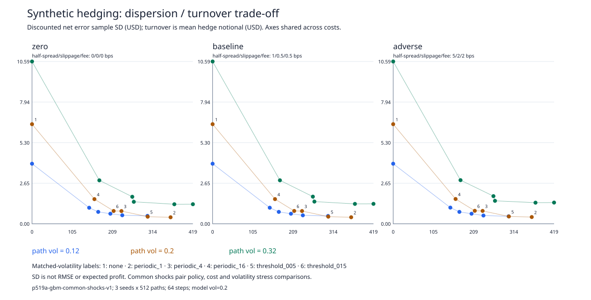

# Synthetic European spot hedging research

## Measured result

With matched 20% volatility, every-grid hedging reduced zero-cost discounted-error RMSE from **$6.4999 unhedged to $0.4232**. Baseline costs raised it to $0.4311. At adverse costs, the 0.05 threshold's $0.5438 RMSE was nearly tied with every-grid's $0.5451: the paired uncertainty and seed rankings do **not** establish a winner. Volatility mismatch produced economically larger shifts in the mean than baseline transaction costs; hedging did not remove that pricing difference.

## Question and scope

Does more frequent delta hedging reduce a short call's terminal error enough to justify its trading costs, and how does a fixed hedge-volatility assumption change that conclusion? This is a controlled **synthetic GBM study**, not a historical backtest, execution forecast, or profitability claim. The reproducible specification is [`examples/hedging_experiment.json`](../examples/hedging_experiment.json).

The position is one short European call, signed effective quantity $Q=-1$, multiplier 1, strike and initial spot $100, maturity 0.25 ACT/365F years, model volatility 20%, funding rate 3%, and dividend yield zero. Initial cash and stock are zero. Entry premium is the model BSM price, not a fitted market quote. All P&L, errors, costs, turnover, and drawdowns are **USD per configured position**, not returns, percentages, or a standard 100-share option contract.

The uniform grid has 64 intervals. Each of seeds 1729, 2718, and 31415 produces 512 paths: 1,536 paths per scenario. Generating diffusion volatilities are 12%, 20%, and 32%; these are not each path's sample realized volatility. Six policies and three cost schedules give 54 pooled scenarios. The same seed, dimensions, and standard-normal draws are reused across volatility stresses; every policy and cost schedule uses the same spots within a stress. Thus comparisons are paired, not independent experiments. Repeated scenario rows do not increase the independent path count.

## Method and accounting

The physical ex-dividend process is $dS/S=\mu\,dt+\sigma_{path}\,dW$, with **physical drift explicitly set to $\mu=r=3\%$ and $q=0$**. Equality with the risk-neutral drift is a study choice, not a general identification of physical and pricing measures. The initial spot is not the implied forward: $F_0=S_0e^{(r-q)T}$. Marks and hedge deltas always use the fixed 20% model volatility; they never learn the generating volatility or use future observations.

At each eligible grid observation the target stock inventory is $h=-Q\Delta_{model}$. `none` never opens a hedge; `periodic_1`, `periodic_4`, and `periodic_16` rebalance at inception and every 1, 4, or 16 intervals before expiry. `threshold_005` and `threshold_015` observe every grid point and rebalance fully to target only when the absolute inventory gap **strictly exceeds** 0.05 or 0.15 underlying units. They are not continuously monitored barriers. All policies cash-settle the option and liquidate any stock at expiry.

The cash account is self-financing: option entry, stock purchases/sales, option settlement, and fees change cash; there are no later capital injections. Positive and negative cash compound at the same continuously compounded rate. Dividend carry is a left-point cash credit $hS q\,dt$ (zero here). Equity is cash plus stock at mid plus the signed model option mark. Attribution is

$$
\mathrm{P\&L}_{\rm nominal}
= \mathrm{P\&L}_{\rm option} + \mathrm{P\&L}_{\rm stock}
+ \mathrm{interest} + \mathrm{dividends}
- \mathrm{fees} - \mathrm{spread} - \mathrm{slippage}.
$$

Stock realized/unrealized P&L uses average mid-price cost; execution costs and carry are realized separately. The saved example ledger contains all 65 epochs, including opening and closing events; event cashflows must not be summed as though they were cumulative cash balances.

### Costs and activity

| Schedule | Half-spread | Slippage | Fee |
|---|---:|---:|---:|
| `zero` | 0 bps | 0 bps | 0 bps |
| `baseline` | 1 bps | 0.5 bps | 0.5 bps |
| `adverse` | 5 bps | 2 bps | 2 bps |

A stock buy executes above mid and a sale below mid by half-spread plus slippage. Fees apply to absolute **executed-price** notional; spread and slippage attribution use absolute mid notional. Costs include opening trades and terminal liquidation; there are no option transaction costs. Baseline and adverse charges are approximately 2 and 9 bps per traded mid notional, with a small execution-price fee adjustment. Turnover is absolute executed stock notional, not a count or a portfolio-normalized ratio. Trade counts include nonzero opening/closing stock trades but exclude option transactions.

Cost drag is the paired difference `zero-cost nominal P&L − charged nominal P&L` on the same path and policy. It includes the funding effect of earlier cost payments, so it is not simply the sum of fees, spread, and slippage. Because these policies depend on model delta and inventory rather than cash, costs do not change their hedge decisions.

### Error, risk, and simulation uncertainty

The reported discounted hedge error is $E=e^{-rT}V_T-V_{pre}$; here $V_{pre}=0$, so nominal P&L is $e^{rT}E$. Its mean (also labelled bias) is not removed before computing RMSE:

- **Path SD:** sample standard deviation of $E$ across paths; dispersion around the sample mean, with denominator $N-1$.
- **RMSE:** $\sqrt{N^{-1}\sum E_i^2}$; includes both dispersion and a nonzero mean. Exactly, $RMSE^2=(N-1)s^2/N+\bar E^2$.
- **MC mean SE:** $s/\sqrt N$; numerical uncertainty in the estimated expectation, not path risk. Approximate 95% mean intervals use $\bar E\pm1.96\,SE$; they are not 95% outcome ranges or guarantees.
- **Paired comparison SE:** calculated from within-path differences, preserving shared shocks. Squared-error differences have USD² units; their SE is not an RMSE SE.

The 5th/95th percentiles are empirical linear-interpolated path quantiles, not confidence bounds. Mean absolute residual delta is time-weighted post-trade exposure in underlying units; even zero residual at every rebalance does not remove between-grid gamma risk. Drawdown is the sampled peak-to-trough equity decline in USD, including inception costs; finer intragrid losses are unobserved.

### Analytical benchmark for volatility mismatch

With this study's $\mu=r$, $q=0$, zero transaction costs, and self-financing adapted stock trades, expected discounted stock gains vanish. Consequently every policy has the same theoretical expected error:

$$
\mathbb{E}[E] =
Q\left[V_{\rm BSM}(S_0,K,T;r,q=0,\sigma_{\rm path}) - P_{\rm entry}\right].
$$

At matched volatility the benchmark is zero. At 12% a short call sold at the 20% premium has positive expected error; at 32% it has negative expected error. Hedging changes the distribution, not this zero-cost expectation. A finite-grid hedge cannot generally eliminate mismatch risk, and a positive mismatch mean is not evidence that one policy creates alpha. Transaction costs lower the expectation by discounted cost drag. This benchmark depends on the chosen drift and cannot be carried unchanged into a different physical-return model.

## Reproduction and evidence

From the repository root, using the project's installed environment:

```bash
uv run python -m quant_pricing.hedge_experiment \
  examples/hedging_experiment.json --output-dir /tmp/hedging-experiment
```

For a single path or policy in Python, use the same engine directly. For example,
this run starts from a supplied synthetic forward, not a spot quote:

```python
from quant_pricing.hedge_paths import GBMConfig, generate_gbm, spot_from_forward
from quant_pricing.hedging import (
    HedgeContract, HedgeCosts, HedgePolicy, prepare_market, simulate_hedge,
)

contract = HedgeContract("put", 100, 0.25, 0.20, rate=0.03, quantity=1)
s0 = spot_from_forward(101, contract.maturity, contract.rate, contract.dividend_yield)
spots = generate_gbm(GBMConfig(s0, 0.03, 0.20, contract.maturity, 64, 1, 1729))
market = prepare_market(contract, spots)
run = simulate_hedge(contract, market, HedgePolicy("periodic", every=4),
                     HedgeCosts(1, 0.5, 0.5), trace_path=0)
print(run.ledger[-1].cash, run.final_pnl[0])
```

The completed run used Python 3.13.5, NumPy 2.5.1, SciPy 1.18.0, and quant_pricing 0.1.0. Its canonical configuration SHA-256 is `bf35896c43a57c2dc851fa5ec2b6c6485274c2e87c032cd3cee831a36b059511`. Generation uses `synthetic-gbm-pcg64-v1`, NumPy PCG64, and time-major C-order standard normals. Preserve seeds, dimensions, parameters, and dependency versions for replay; changing path count changes the random-stream layout, and cross-version/platform bitwise identity is not promised.

The command emits `results.json` (configuration, source/runtime/generation provenance, spot-array hashes, and summaries), `summary.csv`, `per_seed_summary.csv`, `paired_comparisons.csv`, `path_results.csv`, `example_ledger.csv`, and `hedging_tradeoff.svg`. The latter six supply pooled statistics, seed diagnostics, paired uncertainty, path-level attribution, the complete selected ledger, and a measured-results chart respectively. Rerunning replaces these artifact names in the chosen directory.

The saved [pooled results CSV](hedging-results.csv) contains all 54 scenarios. Tables below are rounded from the generated artifacts, not theoretical forecasts.

Verification fingerprints for the recorded environment:

- `results.json` → `provenance.experiment_sha256`: `2579dc963210ee0e1ac5a534b8772dbff130ac0dcd938483fe1807680316adb9`
- `summary.csv` file SHA-256: `dd550e0b7d5442d955870b86ddfb3165765559bf294927b7df5a238ac7d40071`



### Matched volatility: risk versus trading

All error columns are discounted USD; turnover and drag are nominal USD. Each row has 1,536 paths. “Drag” is the baseline paired mean cost drag, including funding; activity columns use baseline costs.

| Policy | Zero RMSE | Baseline mean | Baseline path SD | Baseline RMSE | Adverse RMSE | Mean trades | Mean turnover | Mean drag |
|---|---:|---:|---:|---:|---:|---:|---:|---:|
| `none` | 6.4999 | −0.1489 | 6.5003 | 6.4999 | 6.4999 | 0.00 | 0.00 | 0.0000 |
| `periodic_1` | 0.4232 | −0.0718 | 0.4252 | 0.4311 | 0.5451 | 64.79 | 360.53 | 0.0724 |
| `periodic_4` | 0.8287 | −0.0763 | 0.8305 | 0.8337 | 0.8721 | 17.00 | 232.68 | 0.0467 |
| `periodic_16` | 1.6093 | −0.1131 | 1.6098 | 1.6132 | 1.6321 | 5.00 | 162.37 | 0.0326 |
| `threshold_005` | 0.4611 | −0.0548 | 0.4630 | 0.4661 | 0.5438 | 23.01 | 300.98 | 0.0604 |
| `threshold_015` | 0.8358 | −0.0920 | 0.8368 | 0.8416 | 0.8794 | 7.39 | 212.33 | 0.0426 |

Every-grid trading has the lowest measured RMSE at zero and baseline costs. The 0.05 threshold reduces trades much more than notional: 23.01 versus 64.79 trades, but $300.98 versus $360.53 turnover. That distinction matters for proportional costs. Coarser periodic trading saves costs but materially increases residual risk. `none` is identical under all schedules because it trades no stock.

The baseline every-grid mean is −$0.07181 (MC SE $0.01085; approximate 95% mean interval [−$0.09308, −$0.05054]), versus nominal mean P&L −$0.07235. Its path 5th/95th error percentiles are −$0.79085 and $0.61461: these are much wider than uncertainty about the mean. Its mean drag is $0.072376 (paired SE $0.000519), versus $0.060416 (SE $0.000489) for the 0.05 threshold.

Paired squared-error differences, **policy minus `periodic_1`**, clarify the rankings:

| Volatility | Costs | Policy | Mean squared-error difference (USD²) | Paired SE (USD²) |
|---|---|---|---:|---:|
| 20% | Baseline | `periodic_4` | +0.50920 | 0.03533 |
| 20% | Baseline | `threshold_005` | +0.03140 | 0.00474 |
| 20% | Adverse | `threshold_005` | −0.00144 | 0.00615 |
| 32% | Adverse | `threshold_005` | −0.30675 | 0.05083 |
| 32% | Adverse | `threshold_015` | −0.50569 | 0.19327 |

At matched volatility/adverse costs, the threshold comparison's approximate 95% interval is [−0.01350, +0.01063] USD². The tiny pooled RMSE advantage is unresolved. Under the 32% stress, thresholds improve measured squared error relative to every-grid trading, but the two threshold rows alone do not test them against each other. These are exploratory comparisons across many scenarios, not multiplicity-adjusted policy-selection claims.

### Volatility mismatch: theory and measurement

An independent closed-form calculation gives entry premium **$4.357619** and implied initial forward **$100.752820**. The benchmark below is calculated analytically; means and uncertainty come from zero-cost `periodic_1` artifacts.

| Path volatility | Theoretical expected error | Measured mean | MC mean SE | Approximate 95% mean interval |
|---|---:|---:|---:|---|
| 12% | +1.58107 | +1.56829 | 0.01314 | [1.54255, 1.59404] |
| 20% | 0.00000 | +0.00003 | 0.01080 | [−0.02115, 0.02120] |
| 32% | −2.37539 | −2.36228 | 0.03257 | [−2.42611, −2.29845] |

All three theoretical means lie within these approximate MC intervals. The matched near-zero mean does not imply pathwise replication: zero-cost path SD is $0.42336 on this finite grid.

| Path volatility | Zero mean / SD / RMSE | Baseline mean / SD / RMSE | Adverse mean / SD / RMSE |
|---|---|---|---|
| 12% | 1.5683 / 0.5148 / 1.6506 | 1.5085 / 0.5085 / 1.5918 | 1.2990 / 0.4884 / 1.3877 |
| 20% | 0.0000 / 0.4234 / 0.4232 | −0.0718 / 0.4252 / 0.4311 | −0.3232 / 0.4391 / 0.5451 |
| 32% | −2.3623 / 1.2764 / 2.6849 | −2.4457 / 1.3001 / 2.7696 | −2.7377 / 1.3848 / 3.0678 |

This table holds policy fixed at `periodic_1`. At 12%, charging more costs **reduces RMSE** because it erodes a positive mean toward zero; it does not improve wealth or make trading beneficial. At 32%, costs deepen the loss and raise RMSE. Thus zero-target RMSE alone is not a sufficient economic objective when entry premium differs from the generating-volatility value. Mean, dispersion, turnover, and cost must be considered separately.

### Seed stability and a cash-account example

Each seed contributes 512 paths. Zero-cost every-grid means retain the mismatch signs, while the matched mean fluctuates around zero:

| Seed | 12% mean | 20% mean ± MC SE | 32% mean | 20% adverse RMSE: every-grid | 20% adverse RMSE: 0.05 threshold |
|---|---:|---|---:|---:|---:|
| 1729 | +1.55535 | −0.02317 ± 0.01876 | −2.4244 | 0.56619 | 0.57305 |
| 2718 | +1.57087 | −0.00633 ± 0.01938 | −2.3597 | 0.56149 | 0.54603 |
| 31415 | +1.57866 | +0.02957 ± 0.01793 | −2.3027 | 0.50566 | 0.51059 |

Every-grid beats the 0.05 threshold in two of three matched/adverse seed runs; the pooled ranking reverses. This is direct evidence against treating the narrow aggregate advantage as a stable winner. These seed means are diagnostics of simulation variation, not three historical market regimes.

The selected ledger is seed 1729, path 0, 20% generating volatility, `periodic_1`, baseline costs. At inception it receives $4.357619 premium, buys 0.549738 stock units at $100.015, and has cash −$50.627198 and equity −$0.010995 after costs. At expiry, spot is $79.481472, both positions are zero, and cash/equity is $0.264110. Summed option cashflow $4.357619, hedge cashflow −$3.964476, cash interest −$0.120001, and fees −$0.009032 reconcile to that terminal cash (rounding aside). Hedge cashflow already includes spread/slippage, so subtracting them again would double-count costs. Realized P&L is $0.264110 and unrealized P&L is zero. This single trace illustrates settlement and financing, not typical strategy performance.

## Limits and stopping rule

The study assumes a continuous lognormal spot process, constant rates and volatilities, frictionless option entry/settlement, and symmetric unlimited funding. There are no jumps, stochastic volatility, bid/ask option marks, discrete dividends, borrow constraints, market impact, liquidity limits, latency, margin calls, or early exercise. Cost schedules are assumptions rather than observed execution estimates. Only one short call, horizon, grid, and three fixed seeds are studied; seed stability is a diagnostic, not out-of-sample validation. No thresholds are tuned on held-out data.

The next implementation slice is **19b**: on the same paths, execute an identical mandatory stock target immediately or in precommitted stages. Compare tracking-error MSE and execution cost under a predeclared objective. Add independent seeds or refine the grid if sampling uncertainty blocks that comparison—not to select a more flattering threshold. The present stopping point is a synthetic accounting baseline, not an optimal policy or a historical trading result.
